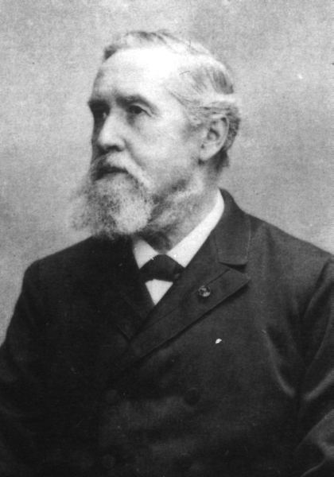
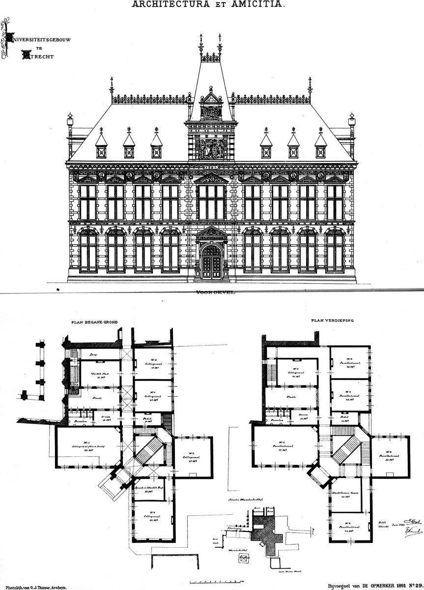

# 01｜古格爾（Eugen Gugel，1832–1905）

**台夫特第一位建築教授（1864–1902）**

## 把建築從工程的附屬，教成一門獨立的學問

*古格爾肖像。（作者不詳，公有領域）*

古格爾（Eugen Gugel）1832年生於普法爾茨的貝格察伯恩（Bergzabern），1850至1856年在慕尼黑的綜合技術學校與藝術學院受訓，師事建築師朗格（Ludwig Lange）。他早年任職巴伐利亞國鐵，參與布倫納鐵路（Brenner）的工程，也替下巴伐利亞設計了數座法院，甚至主持過國王馬克西米利安二世在施塔恩貝格湖畔的夏宮工程，可惜國王1864年驟逝，工程只完成了基礎。

*古格爾與Nieuwenhuis的烏特勒支學院大樓設計圖，1891年。（公有領域，Wikimedia Commons）*

同一年，荷蘭部長托爾貝克（Thorbecke）向朗格請益，朗格推薦了古格爾；1864年8月17日，一紙皇家敕令讓他成為台夫特綜合技術學校的建築教授，此後一教就是三十八年。他出版的四卷本《建築形式學》（Architectonische Vormleer，1880–1888）與《建築風格史》，是荷蘭第一代建築工程師的共同教科書。

筆者認為，古格爾的意義不在於某一棟建築，而在於他把「美的建築」（schoone bouwkunst）帶進一所以工程為主的學校，**讓建築在台夫特第一次擁有自己的教授、自己的課表與自己的教科書**。日後所有關於傳統與現代的爭論，恐怕都是在他打下的這個制度基礎上展開的。

## 代表作品

| 作品 | 年代 |
| --- | --- |
| 布倫納鐵路相關構造物（Brenner railway） | 1857–1859 |
| 下巴伐利亞數座法院 | 1860年代初 |
| 《建築形式學》（Architectonische Vormleer）四卷 | 1880–1888 |
| 烏特勒支大學學院大樓（Academiegebouw，與Nieuwenhuis合作）設計 | 1891 |

## 參考資料

1. [Klinkhamer, J.F.（1902），Eugen Gugel, hoogleeraar aan de Polytechnische School，《Elsevier's Geïllustreerd Maandschrift》](https://www.dbnl.org/tekst/_els001190201_01/_els001190201_01_0034.php)
2. [OverHolland：Bouwkunde in Delft, een chronologie 1842–2000](https://overholland.ac/index.php/overholland/nl/article/download/254/277/308)

[← 回到建築師索引](README.md)
