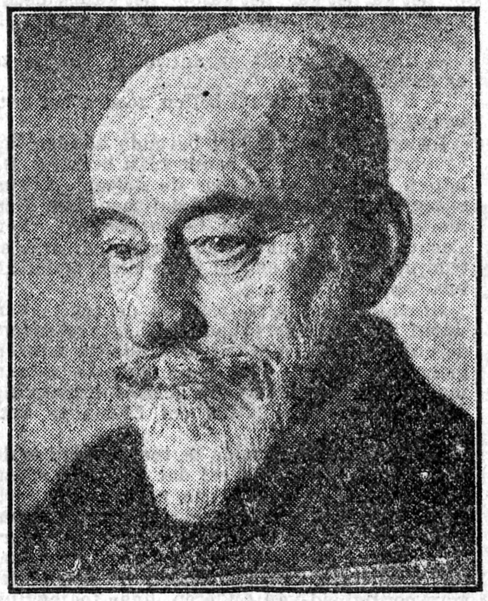
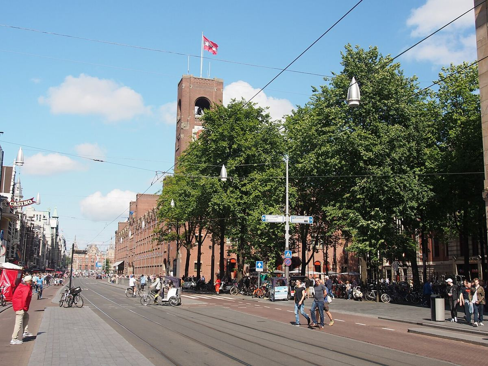

# 02｜貝拉赫（Hendrik Petrus Berlage，1856–1934）

**荷蘭現代建築之父；1905年在台夫特演講**

## 一棟交易所，替荷蘭現代建築定下了磚牆與空間的文法

*貝拉赫，1924年。（攝影者不詳，公有領域）*

貝拉赫（H.P. Berlage）1856年生於阿姆斯特丹，1875至1878年就讀蘇黎世聯邦理工學院（ETH Zurich），之後在歐洲遊歷約三年。他最知名的作品是阿姆斯特丹的商品交易所（Beurs van Berlage，1898–1903）：承重的清水磚牆、毫不掩飾的構造，以及以空間為優先的設計原則，後來被視為荷蘭「即物主義」（Hollandse Zakelijkheid）的起點。

*阿姆斯特丹Damrak街旁的商品交易所鐘塔。（Alf van Beem攝，公有領域）*

他的影響力橫跨幾乎所有1920年代的荷蘭建築流派：傳統主義者、阿姆斯特丹學派、風格派與新即物主義者，都能在他身上找到源頭。1911年訪美之後，他也成為萊特（Frank Lloyd Wright）在歐洲的重要引介者；1932年，他獲頒英國皇家建築師學會金質獎章（RIBA Royal Gold Medal）。

貝拉赫並未在台夫特任教，卻與台夫特有幾段關鍵的交會：1905年他應學生社團Practische Studie之邀演講，當時還是學生的格蘭普雷・莫利耶寫下了報導；1970年的建築系館位於以他命名的Berlageweg；2012年，以他命名的Berlage研究院遷入台夫特。換句話說，**他不屬於任何一個學派，卻是每一個學派都必須回應的提問者**。

## 代表作品

| 作品 | 年代 |
| --- | --- |
| [阿姆斯特丹商品交易所（Beurs van Berlage）](https://en.wikipedia.org/wiki/Beurs_van_Berlage) | 1898–1903 |
| [倫敦荷蘭大樓（Holland House）](https://en.wikipedia.org/wiki/Hendrik_Petrus_Berlage) | 1916 |
| [台夫特演講〈論建築可能的發展〉](https://pure.uva.nl/ws/files/50255496/Proefschrift.pdf) | 1905 |

## 參考資料

1. [Wikipedia：Hendrik Petrus Berlage](https://en.wikipedia.org/wiki/Hendrik_Petrus_Berlage)
2. [Bruins, H.（2020），M.J. Granpré Molière（UvA博士論文）](https://pure.uva.nl/ws/files/50255496/Proefschrift.pdf)

[← 回到建築師索引](README.md)
