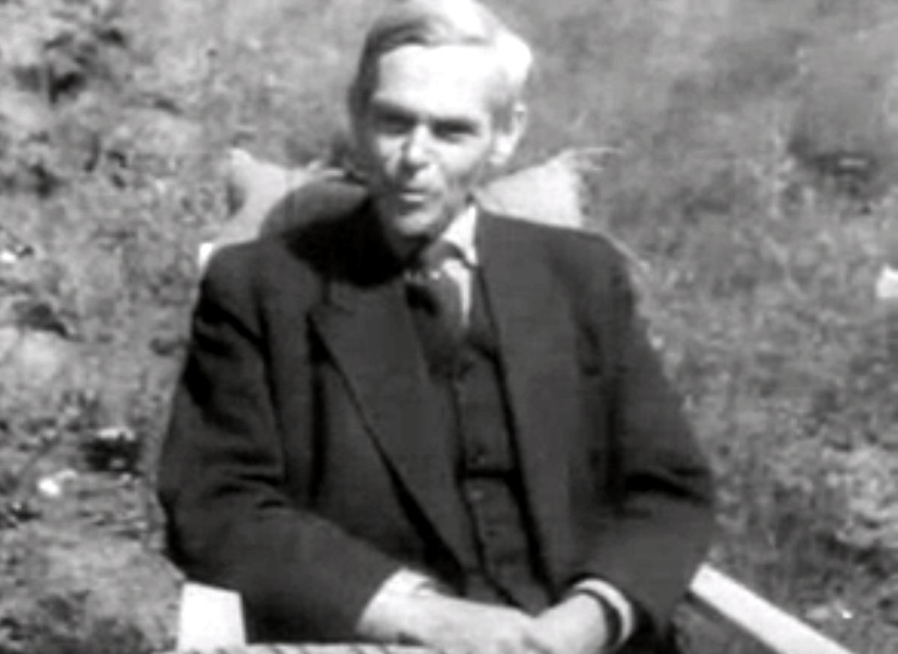
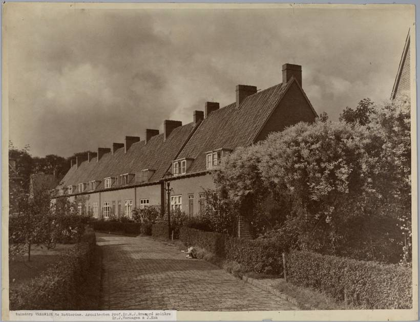

# 03｜格蘭普雷・莫利耶（Marinus Jan Granpré Molière，1883–1972）

**台夫特教授（1924–1953）；台夫特學派創始者**

## 學生推舉的教授，用傳統把現代主義擋在門外

*格蘭普雷・莫利耶，1954年。（Beeld en Geluid／Open Beelden，CC BY-SA 3.0）*

格蘭普雷・莫利耶（M.J. Granpré Molière）1883年生於奧登博斯（Oudenbosch）。1924年，他在學生提議下獲聘為台夫特教授，直到1953年，期間主導的設計教學被稱為「台夫特學派」（Delftse School），也被視為荷蘭傳統主義建築的源頭。

*鹿特丹Vreewijk花園村。（Het Nieuwe Instituut典藏，無著作權限制）*

他的設計從鹿特丹的Vreewijk花園村（1916–1919，與Verhagen、Kok合作）起步，強調地方傳統、手工與磚造；1927年起參與威靈厄梅爾（Wieringermeer）、1937年起參與東北圩田（Noordoostpolder）等新生地的規劃，把「村落」的理想帶進國家級的填海工程。依據Bruins（2020）的研究，他自認是承接居伊柏斯與貝拉赫，卻更著迷於自發生成的「無意識之美」。

筆者認為，他的歷史評價恐怕不能只以「反現代」一筆帶過。**台夫特學派的力量，不在於它拒絕了什麼，而在於它讓一整個世代的工程師相信：建築必須回應土地、社群與生活方式**。只是這份信念，後來也成了學系改革時首先被挑戰的權威。

## 代表作品

| 作品 | 年代 |
| --- | --- |
| [鹿特丹Vreewijk花園村（與Verhagen、Kok合作）](https://nl.wikipedia.org/wiki/Vreewijk_(Rotterdam)) | 1916–1919 |
| [鹿特丹Kralingse Bos公園與IJsselmonde島規劃](https://nl.wikipedia.org/wiki/Kralingse_Bos) | 1921 |
| [Huize De Boogerd住宅，鹿特丹Kralingen](https://tudelft.nl/en/community/alumni/inspiring-alumni/historical-alumni/marinus-jan-granpre-moliere) | 1930 |
| [Wieringermeer與Noordoostpolder新生地規劃](https://en.wikipedia.org/wiki/Wieringermeer) | 1927起／1937起 |

## 參考資料

1. [TU Delft Alumni：Marinus Jan Granpré Molière](https://tudelft.nl/en/community/alumni/inspiring-alumni/historical-alumni/marinus-jan-granpre-moliere)
2. [Bruins, H.（2020），M.J. Granpré Molière（UvA博士論文）](https://pure.uva.nl/ws/files/50255496/Proefschrift.pdf)
3. [Wikipedia：Marinus Jan Granpré Molière](https://en.wikipedia.org/wiki/Marinus_Jan_Granpr%C3%A9_Moli%C3%A8re)

[← 回到建築師索引](README.md)
