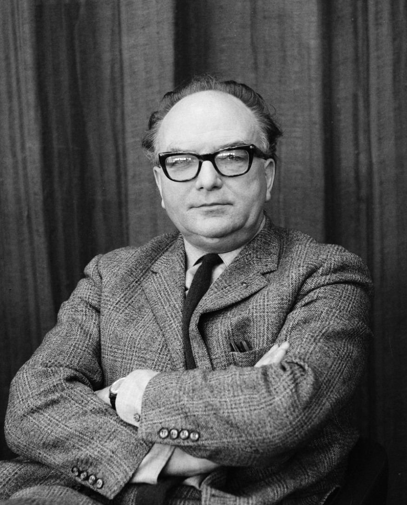
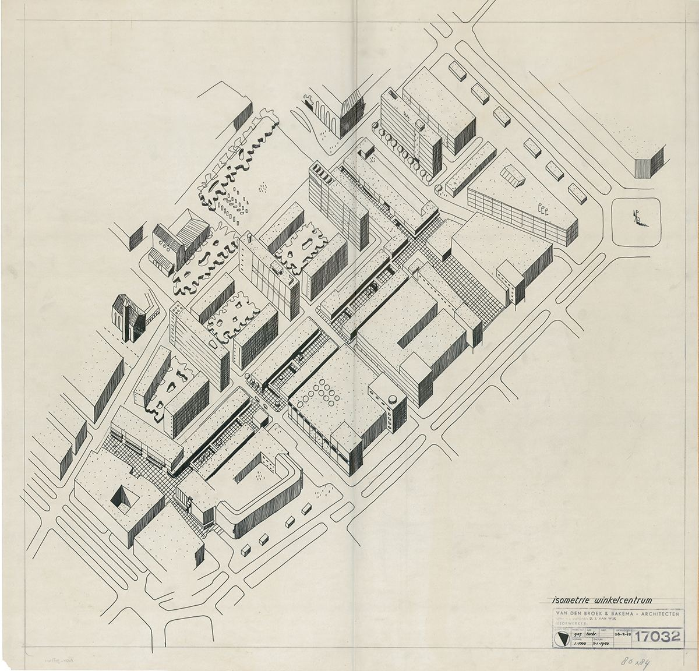

# 06｜貝克瑪（Jaap Bakema，1914–1981）

**台夫特教授（1963–1981）；Team 10核心成員**

## 把城市當成一連串可以被使用的關係來設計

*貝克瑪，1966年。（Ron Kroon／Anefo，CC BY-SA 3.0 nl）*

貝克瑪（Jaap Bakema）1914年生於格羅寧根，先後在格羅寧根高等技術學校與阿姆斯特丹建築學院學習，師事斯塔姆（Mart Stam），1941年以優異成績畢業。1946年起參加國際現代建築會議（CIAM），1955年擔任秘書，也是質疑功能主義、主張回到人本的Team 10核心成員，並與凡艾克、赫茲伯格共同編輯《Forum》雜誌。

*Lijnbaan商店街的設計鳥瞰圖，1940年代末。（Het Nieuwe Instituut典藏，無著作權限制）*

他與范登布魯克合作的作品遍及荷蘭與德國：鹿特丹Lijnbaan商店街、柏林Interbau國際建築展的漢莎區住宅（Hansaviertel，1957）、德國馬爾市民中心（1958–1962）、特爾訥曾市政廳（1963–1972），以及台夫特的建築系館與大禮堂。1963年起他在台夫特任教，直到1981年過世；1965年起也兼任漢堡的教授。

貝克瑪最打動筆者的，是他對「建築師社會責任」的堅持。**他設計的不只是建築物，而是建築物之間的街道、廣場與相遇**；這也是今天台灣討論步行街區時，仍然值得回頭閱讀Lijnbaan的原因。

## 代表作品

| 作品 | 年代 |
| --- | --- |
| [鹿特丹Lijnbaan商店街（與Van den Broek合作）](https://en.wikipedia.org/wiki/Lijnbaan) | 1949–1953 |
| [柏林Hansaviertel住宅（Interbau）](https://en.wikipedia.org/wiki/Hansaviertel) | 1957 |
| [德國馬爾市民中心](https://de.wikipedia.org/wiki/Rathaus_Marl) | 1958–1962 |
| [台夫特建築系館與大禮堂](https://nl.wikipedia.org/wiki/Faculteitsgebouw_Bouwkunde_(TU_Delft)) | 1959–1970 |
| [特爾訥曾市政廳](https://nl.wikipedia.org/wiki/Stadhuis_van_Terneuzen) | 1963–1972 |

## 參考資料

1. [Wikipedia：Jaap Bakema](https://en.wikipedia.org/wiki/Jaap_Bakema)
2. [TU Delft Open：Van den Broek & Bakema at the TH Delft](https://books.bk.tudelft.nl/press/catalog/book/680)

[← 回到建築師索引](README.md)
