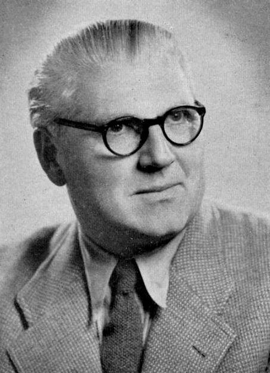
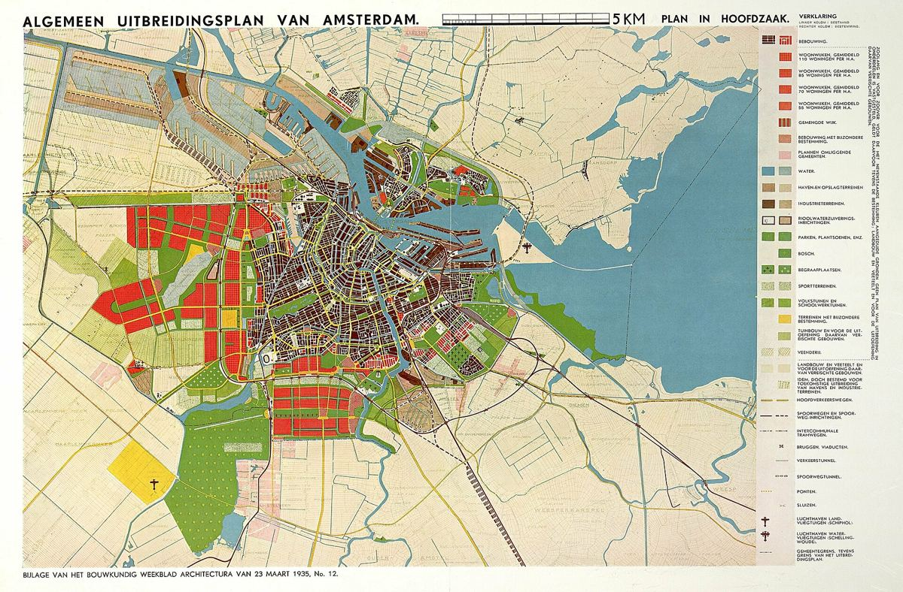

# 07｜范埃斯特倫（Cornelis van Eesteren，1897–1988）

**台夫特都市計畫教授（1947–1967）；CIAM主席（1930–1947）**

## 從風格派的構成圖，走到一整座城市的擴展計畫

*范埃斯特倫，1949年。（攝影者不詳，公有領域，Delpher）*

范埃斯特倫（Cornelis van Eesteren）1897年生於阿爾布拉瑟丹（Alblasserdam）。他早年與杜斯伯格（Theo van Doesburg）合作，1923年加入風格派（De Stijl），兩人共同製作的建築模型曾在巴黎展出；之後他贏得柏林菩提樹下大街（Unter den Linden）的設計競圖，並到威瑪的國立建築高等學校擔任客座教授。

*《阿姆斯特丹擴展計畫》1935年版總圖。（Cornelis van Eesteren，公有領域）*

1929至1959年間，他任職於阿姆斯特丹市政府都市計畫部門，與范洛赫森（Th.K. van Lohuizen）以人口與土地需求的調查為基礎，擬定1934年的《阿姆斯特丹擴展計畫》（AUP），戰後的西部花園城市即依此興建。1930至1947年，他擔任國際現代建築會議（CIAM）主席；戰後則成為台夫特的都市計畫教授，也參與南部須德海圩田與萊利斯塔德（Lelystad）的規劃。

筆者特別喜歡他的這條軌跡：**一位畫過紅黃藍構成圖的風格派成員，最後畫的是一整座城市的土地使用圖**。這也正是本故事地圖採用風格派視覺語言的原因。

## 代表作品

| 作品 | 年代 |
| --- | --- |
| [與杜斯伯格合作的建築模型（Maison particulière等）](https://efl-stichting.nl/en/over-c-van-eesteren/) | 1923 |
| [柏林Unter den Linden設計競圖首獎](https://en.wikipedia.org/wiki/Cornelis_van_Eesteren) | 1920年代 |
| [《阿姆斯特丹擴展計畫》（AUP，與Van Lohuizen合作）](https://nl.wikipedia.org/wiki/Algemeen_Uitbreidingsplan) | 1934 |
| [Slotermeer花園城市設計](https://en.wikipedia.org/wiki/Slotermeer) | 1939 |
| [萊利斯塔德（Lelystad）市鎮規劃](https://en.wikipedia.org/wiki/Lelystad) | 戰後 |

## 參考資料

1. [EFL Stichting：About Cornelis van Eesteren](https://efl-stichting.nl/en/over-c-van-eesteren/)
2. [Wikipedia：Cornelis van Eesteren](https://en.wikipedia.org/wiki/Cornelis_van_Eesteren)
3. [OverHolland：Bouwkunde in Delft, een chronologie 1842–2000](https://overholland.ac/index.php/overholland/nl/article/download/254/277/308)

[← 回到建築師索引](README.md)
