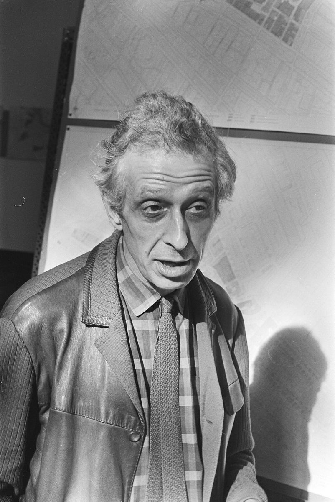
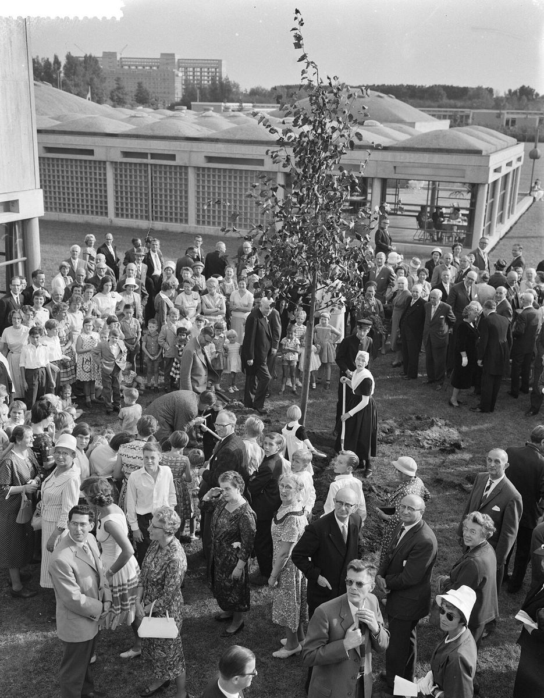

# 08｜凡艾克（Aldo van Eyck，1918–1999）

**台夫特教授（1966–1984）；Team 10共同創立者**

## 用孤兒院證明，建築可以像一座小城市

*凡艾克，1970年。（Anefo，CC0）*

凡艾克（Aldo van Eyck）1918年生於德里伯亨（Driebergen），在英國與海牙完成中學，1942年畢業於蘇黎世聯邦理工學院。他是CIAM成員，1954年共同創立Team 10，主張拒絕僵化的功能主義、回到人本；1959至1963年間與貝克瑪、赫茲伯格共同編輯《Forum》雜誌，是荷蘭結構主義最具影響力的人物之一。

*1961年9月，阿姆斯特丹市立孤兒院的開幕典禮。（Wim van Rossem／Anefo，CC0）*

他的代表作阿姆斯特丹市立孤兒院（Burgerweeshuis，1955–1960），以重複的方形單元與圓頂組成「像城市一樣的房子」；他也設計了東北圩田的新村Nagele（1948–1954）、Slotermeer的長者住宅（1951–1952）與阿姆斯特丹的Hubertushuis（1973–1978）。他先後任教於阿姆斯特丹建築學院（1954–1959）與台夫特（1966–1984）。

對照本故事地圖，**凡艾克在Slotermeer蓋過長者住宅，正好把范埃斯特倫的城市計畫與貝克瑪、赫茲伯格的結構主義串在一起**。台夫特的這幾位教授，其實是在同一片土地上彼此對話。

## 代表作品

| 作品 | 年代 |
| --- | --- |
| 東北圩田新村Nagele村落設計 | 1948–1954 |
| 阿姆斯特丹Slotermeer長者住宅 | 1951–1952 |
| 阿姆斯特丹市立孤兒院（Burgerweeshuis） | 1955–1960 |
| 阿姆斯特丹Hubertushuis | 1973–1978 |
| ESA-ESTEC餐廳與會議中心，諾德韋克 | 1984–1990 |

## 參考資料

1. [Wikipedia：Aldo van Eyck](https://en.wikipedia.org/wiki/Aldo_van_Eyck)

[← 回到建築師索引](README.md)
