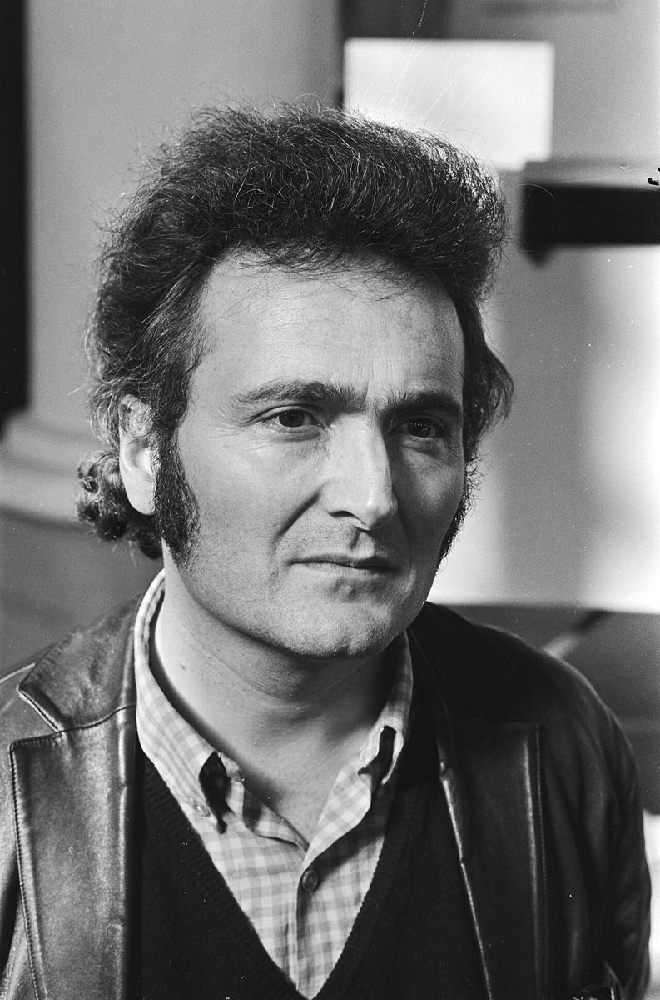
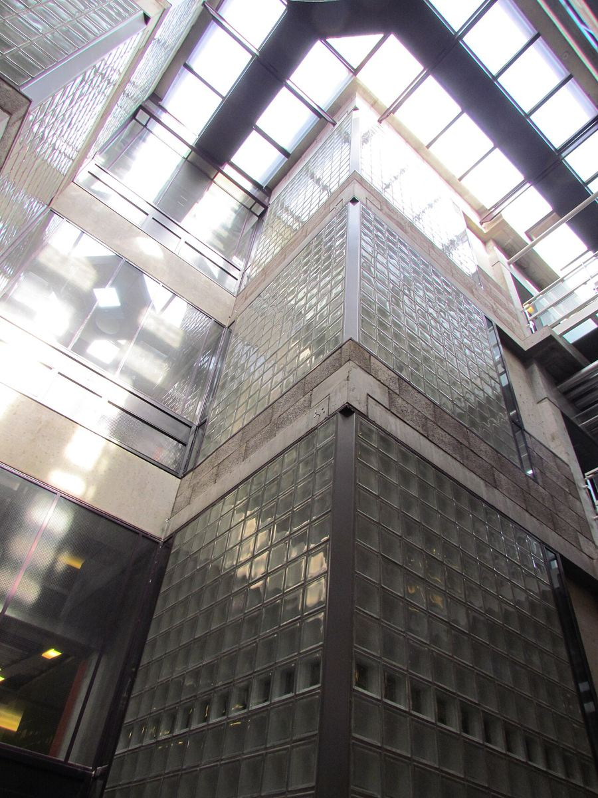

# 09｜赫茲伯格（Herman Hertzberger，1932–）

**台夫特教授（1970–1999）；Berlage研究院創辦人**

## 建築提供結構，使用者完成它

*赫茲伯格，1970年。（Anefo，CC0）*

赫茲伯格（Herman Hertzberger）1932年生於阿姆斯特丹，1958年畢業於台夫特，1959至1963年與凡艾克、貝克瑪共同編輯《Forum》雜誌，1970至1999年在台夫特任教，1990年在阿姆斯特丹創立以貝拉赫命名的Berlage研究院。2012年，他獲頒英國皇家建築師學會金質獎章。

*Centraal Beheer大樓內部的挑空與玻璃磚。（Apdency攝，CC0）*

他的代表作阿佩多恩Centraal Beheer保險公司辦公大樓（1968–1972），以大量重複的方形單元組成，讓員工自己布置、填滿空間；台夫特的蒙特梭利學校（1966–1970）與實驗性的Diagoon住宅（1971）也都在台夫特。他寫的《Lessons for Students in Architecture》（1991）至今仍是許多建築系學生的入門讀物。

這本故事地圖反覆出現的一句話，**「建築提供結構，使用者完成它」，正是從赫茲伯格的思想延伸而來**。BK City的師生在十六年間把一棟避難用的老校舍「使用」成自己的家，大概是對這句話最好的實證。

## 代表作品

| 作品 | 年代 |
| --- | --- |
| [台夫特蒙特梭利學校](https://en.wikipedia.org/wiki/Herman_Hertzberger) | 1966–1970 |
| [台夫特Diagoon實驗住宅](https://nl.wikipedia.org/wiki/Diagoonwoningen) | 1971 |
| [阿佩多恩Centraal Beheer辦公大樓](https://nl.wikipedia.org/wiki/Centraal_Beheergebouw_van_Herman_Hertzberger) | 1968–1972 |
| [烏特勒支Vredenburg音樂中心](https://nl.wikipedia.org/wiki/Muziekcentrum_Vredenburg) | 1978 |
| [布雷達Chassé劇院](https://nl.wikipedia.org/wiki/Chassé_Theater) | 1995 |
| [《Lessons for Students in Architecture》](https://en.wikipedia.org/wiki/Herman_Hertzberger) | 1991 |

## 參考資料

1. [Wikipedia：Herman Hertzberger](https://en.wikipedia.org/wiki/Herman_Hertzberger)
2. [Wikipedia：Berlage Institute](https://en.wikipedia.org/wiki/Berlage_Institute)

[← 回到建築師索引](README.md)
