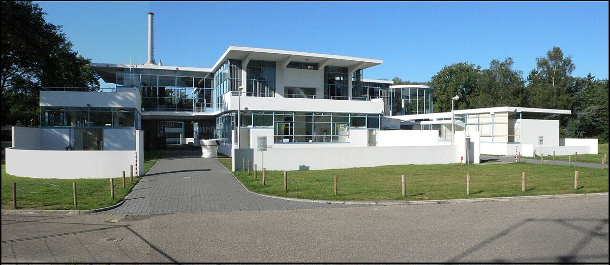
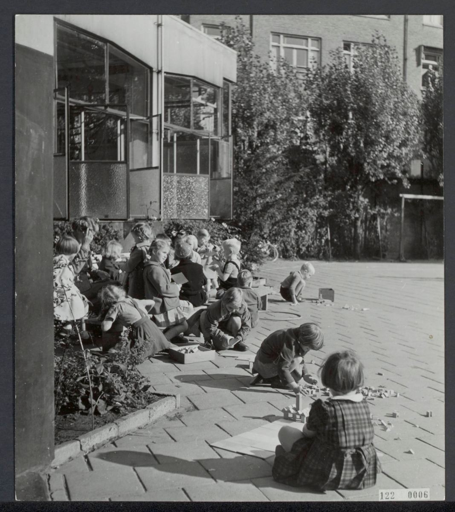

# 05｜杜伊克（Jan Duiker，1890–1935）

**台夫特出身的「新建築」先驅**

## 在傳統主義的學系裡，長出最激進的現代主義者

*Zonnestraal療養院主樓東立面。（Gbulder攝，CC BY-SA 3.0）*

杜伊克（Jan Duiker）1890年生於海牙，先當了一年木工學徒，1908至1913年在台夫特修讀建築，與同學貝伊福特（Bernard Bijvoet）結為終身夥伴，1916年在海牙合開事務所。他被視為荷蘭「新建築」（Nieuwe Bouwen）最重要的建築師：讓鋼、鋼筋混凝土與玻璃以最纖細的方式呈現自身，不加裝飾，追求他所說的「精神的經濟」。

*阿姆斯特丹Cliostraat的露天學校，孩子們在戶外上課。（Emmy Andriesse／Anefo，公有領域）*

他的作品幾乎都與健康有關。希爾弗瑟姆的Zonnestraal療養院（1928，與Bijvoet合作）是為結核病患設計的康復村，依維基百科記載，正是貝拉赫推薦了這對建築師；阿姆斯特丹的露天學校（1929–1930）則讓教室向陽光與空氣打開。1932年起，他擔任刊物《de 8 en Opbouw》總編輯，主張建築應當務實，卻也必須有人性。1935年，他在Gooiland飯店的設計過程中辭世。

弔詭的是，**台夫特學派最堅定的反對者，正是台夫特自己培養出來的學生**。杜伊克的存在提醒我們，一個學系的思想從來不會只有一種聲音。

## 代表作品

| 作品 | 年代 |
| --- | --- |
| [海牙Nirwana公寓](https://nl.wikipedia.org/wiki/Nirwana-flat) | 1927–1930 |
| [希爾弗瑟姆Zonnestraal療養院（與Bijvoet合作）](https://nl.wikipedia.org/wiki/Sanatorium_Zonnestraal) | 1928 |
| [阿姆斯特丹露天學校（Openluchtschool）](https://nl.wikipedia.org/wiki/Eerste_Openluchtschool_voor_het_Gezonde_Kind) | 1929–1930 |
| [阿姆斯特丹Cineac新聞電影院](https://nl.wikipedia.org/wiki/Cineac_(Amsterdam)) | 1934 |
| [希爾弗瑟姆Gooiland飯店](https://nl.wikipedia.org/wiki/Grand_Hotel_Gooiland) | 1934–1936 |

## 參考資料

1. [Modernism in Architecture：Johannes (Jan) Duiker](https://modernism-in-architecture.org/people/architects/johannes-jan-duiker/)
2. [Archiweb：Jan Duiker](https://www.archiweb.cz/en/jan-duiker)
3. [Wikipedia：Jan Duiker](https://en.wikipedia.org/wiki/Jan_Duiker)

[← 回到建築師索引](README.md)
