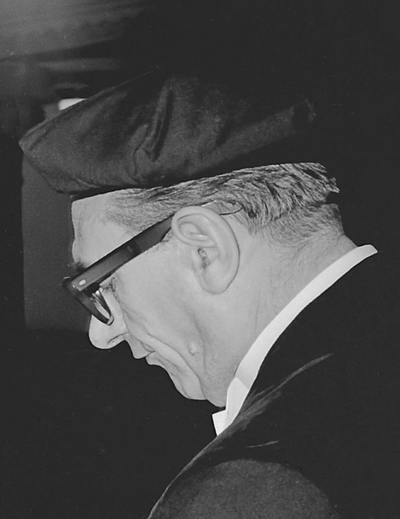
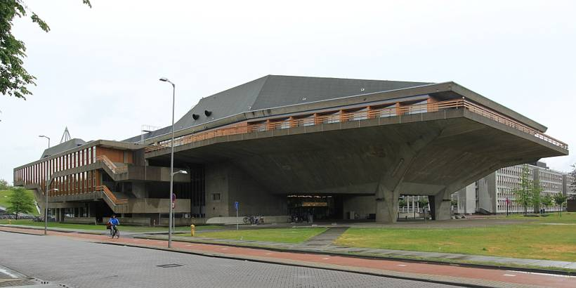

# 06｜范登布魯克（Jo van den Broek，1898–1978）

**台夫特建築教授（1947–1964）**

## 把建築師帶進戰後住宅生產的現代主義者

*范登布魯克，1964年。（Eric Koch／Anefo，CC0）*

范登布魯克（Jo van den Broek）1924年在台夫特完成建築學業，1927年開業，是荷蘭新建築運動的創始成員之一。1937年起，他與布林克曼（Johannes Brinkman）合組事務所，二戰後投入鹿特丹遭轟炸後的重建規劃；1951年，事務所更名為「范登布魯克與貝克瑪」（Van den Broek en Bakema）。

*台夫特理工大學大禮堂（Aula）。（Nol Aders攝，CC BY-SA 3.0）*

1947年，他成為台夫特戰後首批新聘教授之一，任教至1964年，並擔任學院的管理職務。他主張把設計與研究分開來談，也積極推動建築師的專業化，並參與創立鹿特丹的建築研究中心Bouwcentrum。他與貝克瑪合作的鹿特丹Lijnbaan商店街（1949–1953），是戰後鹿特丹重建最具代表性的步行商業街。

筆者認為，范登布魯克的意義在於讓建築師的角色從「藝術家」轉為「社會生產的一環」：**當國家需要大量住宅時，建築教育也必須回答如何大量、快速又有品質地蓋好房子**。

## 代表作品

| 作品 | 年代 |
| --- | --- |
| [Brinkman & Van den Broek事務所，投入鹿特丹戰後重建規劃](https://en.wikipedia.org/wiki/Johannes_Brinkman) | 1937起 |
| [鹿特丹Lijnbaan商店街（與Bakema合作）](https://en.wikipedia.org/wiki/Lijnbaan) | 1949–1953 |
| [台夫特建築系館（Berlageweg）](https://nl.wikipedia.org/wiki/Faculteitsgebouw_Bouwkunde_(TU_Delft)) | 1959–1970 |
| [台夫特大禮堂（Aula）](https://nl.wikipedia.org/wiki/Aula_(TU_Delft)) | 1959–1966 |

## 參考資料

1. [TU Delft Alumni：Johannes Hendrik (Jo) van den Broek](https://tudelft.nl/en/community/alumni/inspiring-alumni/historical-alumni/johannes-hendrik-jo-van-den-broek)
2. [TU Delft Open：Van den Broek & Bakema at the TH Delft](https://books.bk.tudelft.nl/press/catalog/book/680)
3. [Wikipedia：Jo van den Broek](https://en.wikipedia.org/wiki/Jo_van_den_Broek)

[← 回到建築師索引](README.md)
