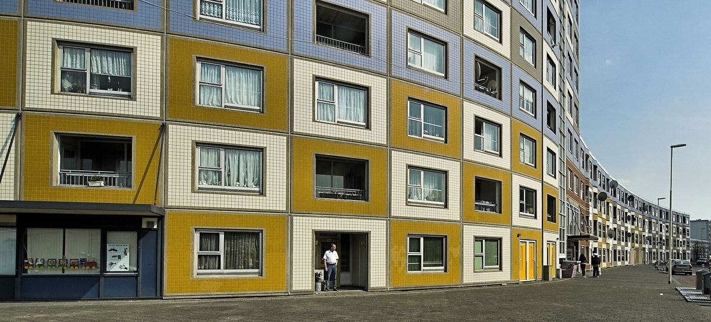

# 11｜韋伯（Carel Weeber，1937–2025）

**台夫特教授（1970–2003）**

## 對「小而美」說不的大尺度建築師

*韋伯，1983年。（Rob Bogaerts／Anefo，CC0）*

韋伯（Carel Weeber）1937年生於奈梅亨（Nijmegen），在台夫特修讀建築，1966年以阿姆斯特丹中央車站的新設計案獲得羅馬大獎（Prix de Rome），1970至2003年擔任台夫特教授，1993至1998年出任荷蘭建築師協會（BNA）主席。

*鹿特丹南區的De Peperklip集合住宅。（Jan Geerling攝，CC BY-SA 4.0）*

1970年代末，荷蘭住宅設計流行小尺度、溫馨的「新拘謹」（Nieuwe truttigheid），韋伯則以一系列大尺度的作品回應，其中最著名的是鹿特丹南區的De Peperklip集合住宅（1979–1982），以一道迴紋針形狀的長條量體圍出整個街廓。1997年，他提出「狂野居住」（Het Wilde Wonen），批評荷蘭住宅建設過於僵化，主張讓居民有更多自由。2025年2月，他在比利時魯汶辭世。

同年9月16日，BK Talks以「Carel Weeber and our contemporary challenges」為題在BK City東側溫室舉辦講座，筆者也在現場。**一位建築師過世半年後，學院用一場公開講座追問他的提問在今天是否仍然成立**，這種與前輩辯論而非膜拜的態度，恐怕正是台夫特最值得借鏡之處。

## 代表作品

| 作品 | 年代 |
| --- | --- |
| [大阪萬博荷蘭館（與Bakema合作）](https://en.wikipedia.org/wiki/Carel_Weeber) | 1970 |
| [鹿特丹Pompenburg](https://nl.wikipedia.org/wiki/Pompenburg) | 1977–1981 |
| [鹿特丹De Peperklip集合住宅](https://nl.wikipedia.org/wiki/De_Peperklip) | 1979–1982 |
| [Spijkenisse地鐵站（荷蘭國家鋼構獎）](https://nl.wikipedia.org/wiki/Spijkenisse_Centrum_(metrostation)) | 1986 |
| [海牙De Struyck學生宿舍](https://en.wikipedia.org/wiki/Carel_Weeber) | 1996 |

## 參考資料

1. [Wikipedia：Carel Weeber](https://en.wikipedia.org/wiki/Carel_Weeber)
2. [OverHolland：Bouwkunde in Delft, een chronologie 1842–2000](https://overholland.ac/index.php/overholland/nl/article/download/254/277/308)

[← 回到建築師索引](README.md)
