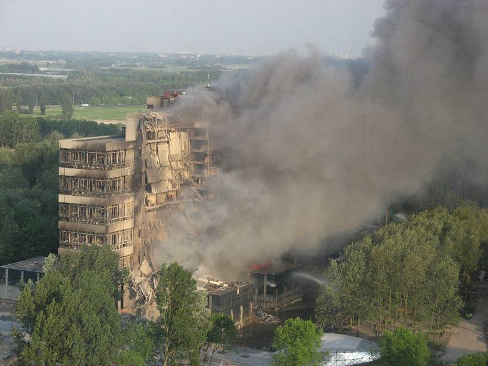

# 12｜博勒瑞（Franziska Bollerey，Prof. from 1979）

**建築與都市史學者；建築系第一位女性教授（1979）**

## 第一位女性教授，也是在大火中失去三十年檔案的歷史學者

*2008年5月13日的大火，也燒掉了博勒瑞三十年的個人研究檔案。（Bryan Tong Minh攝，CC BY 2.5）*

博勒瑞（Franziska Bollerey）是建築與都市史學者，1979年成為台夫特建築系第一位女性教授，研究領域包括都市化的歷史、烏托邦思想、大都會文化與1920年代的建築。

2008年5月的大火，燒掉了她個人蒐集約三十年的檔案，其中包括大量關於女性建築師的歷史文件；部分燒焦的紙張後來被台夫特與鹿特丹一帶的民眾撿到並送還。火災之後，她向世界各地的同行募集書籍與幻燈片，重建自己的研究，近年也為專書撰寫中歐女性建築師的章節。她與范埃斯特倫也曾有長期通信。

她的經歷提醒筆者，**一個學系的記憶，往往寄託在少數人的私人收藏裡**。2008年燒掉的不只是一棟現代主義大樓，還有一位學者三十年來替女性建築師保存下來的證據。

## 代表作品

| 作品 | 年代 |
| --- | --- |
| [台夫特建築系首位女性教授](https://overholland.ac/index.php/overholland/nl/article/download/254/277/308) | 1979 |
| [大火後重建個人研究檔案](https://delta.tudelft.nl/article/15-years-after-fire-historian-without-archive) | 2008起 |
| [中歐女性建築師研究專章](https://delta.tudelft.nl/article/15-years-after-fire-historian-without-archive) | 2020年代 |
| [〈A Room of One's Own〉等論文](https://www.tudelft.nl/staff/f.bollerey/) | 2024 |

## 參考資料

1. [OverHolland：Bouwkunde in Delft, een chronologie 1842–2000](https://overholland.ac/index.php/overholland/nl/article/download/254/277/308)
2. [Delta：15 years after fire, historian without archive](https://delta.tudelft.nl/article/15-years-after-fire-historian-without-archive)
3. [TU Delft：Prof.dr. F. Bollerey](https://www.tudelft.nl/staff/f.bollerey/)

[← 回到建築師索引](README.md)
