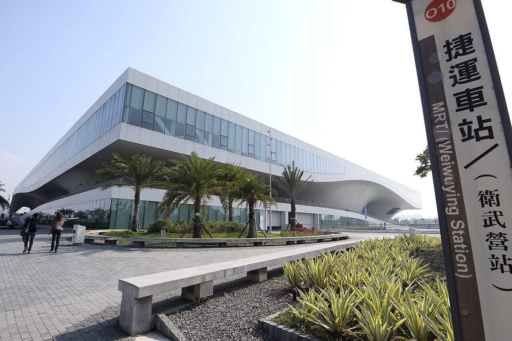

# 13｜胡本（Francine Houben，1955–）

**Mecanoo創辦人；台夫特「移動美學」教授（2000–2009）**

## 從台夫特學生競圖起家，把圖書館蓋成校園的地景

*胡本，2026年。（Joost Pauwels攝，CC0）*

胡本（Francine Houben）1955年生於錫塔德（Sittard）。在台夫特修讀建築期間，她與兩位同學贏得1981年鹿特丹的青年住宅競圖，並由此創立Mecanoo事務所；1984年她以優異成績畢業，至今擔任Mecanoo的創意總監，事務所也一直以台夫特為基地。2000至2009年，她在台夫特擔任「移動美學」（Mobility Aesthetics）教授。

*高雄衛武營國家藝術文化中心，2018年。（MiNe攝，CC BY 2.0）*

她與母校的連結幾乎寫在校園地景上：台夫特理工大學圖書館（1997）以一片長滿草的斜屋頂取代建築立面，屋頂中央穿出一支圓錐；Mekelpark校園公園與台夫特車站也都出自Mecanoo之手。她的作品遍及伯明罕圖書館（2013）、華盛頓特區馬丁路德金紀念圖書館的翻修，以及高雄的衛武營國家藝術文化中心（2018）。2020年，她獲選為TU Delft年度校友。

對台灣讀者而言，衛武營恐怕是最熟悉的「台夫特作品」。**一位在學生競圖中起步的女性建築師，最後在高雄的榕樹林裡蓋出一座大屋頂**，這條線把本頁的故事直接接回了台灣。

## 代表作品

| 作品 | 年代 |
| --- | --- |
| [台夫特理工大學圖書館](https://nl.wikipedia.org/wiki/Bibliotheek_TU_Delft) | 1997 |
| [鹿特丹Montevideo住宅大樓](https://en.wikipedia.org/wiki/Montevideo_(Rotterdam)) | 2005 |
| [伯明罕圖書館](https://en.wikipedia.org/wiki/Library_of_Birmingham) | 2013 |
| [台夫特車站](https://en.wikipedia.org/wiki/Delft_railway_station) | 2015 |
| [高雄衛武營國家藝術文化中心](https://en.wikipedia.org/wiki/National_Kaohsiung_Center_for_the_Arts) | 2018 |
| [華盛頓特區馬丁路德金紀念圖書館翻修](https://en.wikipedia.org/wiki/Martin_Luther_King_Jr._Memorial_Library) | 2020年代 |

## 參考資料

1. [Mecanoo：Francine Houben TU Delft Alumnus of the Year 2020](https://www.mecanoo.nl/News/ID/508/Francine-Houben-TU-Delft-Alumnus-of-the-Year-2020)
2. [Wikipedia：Francine Houben](https://en.wikipedia.org/wiki/Francine_Houben)
3. [OverHolland：Bouwkunde in Delft, een chronologie 1842–2000](https://overholland.ac/index.php/overholland/nl/article/download/254/277/308)

[← 回到建築師索引](README.md)
