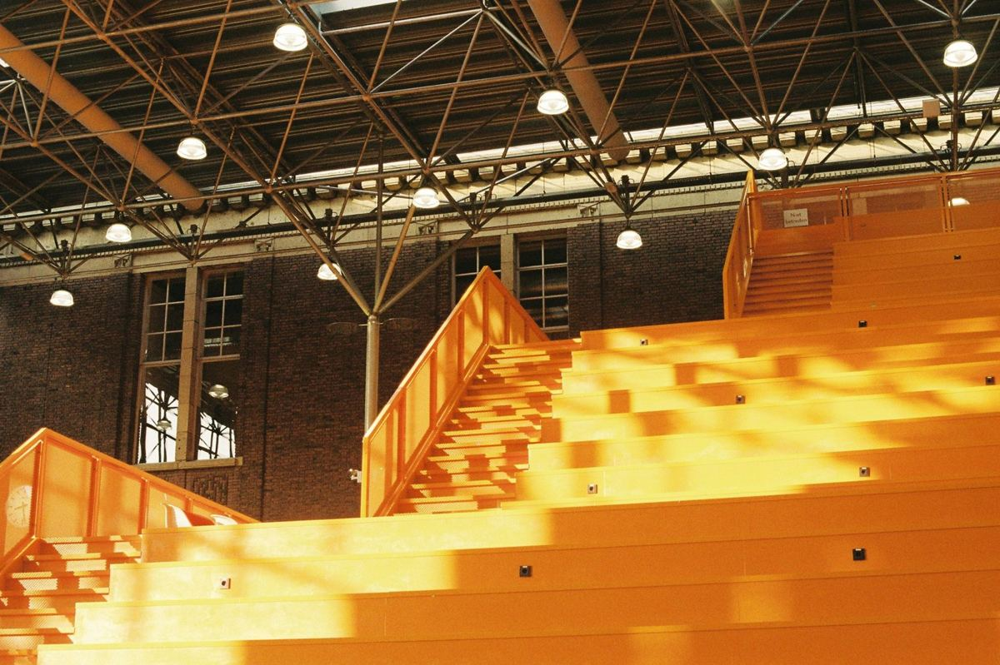
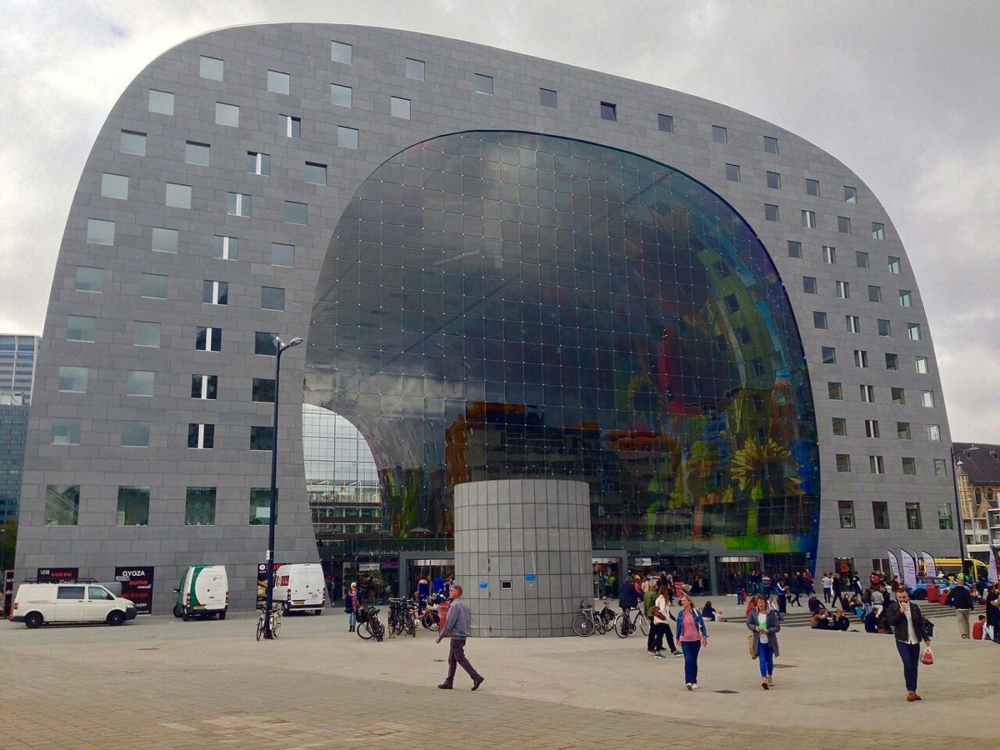

# 14｜德弗里斯（Nathalie de Vries，1965–）

**MVRDV共同創辦人；台夫特「建築設計：公共建築」教授**

## MVRDV的共同創辦人，也是BK City東側溫室的設計者之一

*BK City東側溫室的橘色階梯看台，MVRDV負責此溫室的室內設計。（吳昀慶攝，底片）*

德弗里斯（Nathalie de Vries）1965年生於阿平厄丹（Appingedam），1990年畢業於台夫特，1993年與馬斯（Winy Maas）、范萊斯（Jacob van Rijs）共同創立MVRDV，事務所名稱就是三人姓名的縮寫。她曾任柏林工業大學（2002–2004）與杜塞道夫藝術學院的教授，以及荷蘭國鐵與ProRail的首席鐵道建築師（2005–2008），並擔任荷蘭建築師協會（BNA）主席至2019年；2018年獲聘為台夫特「建築設計：公共建築」教授。

*鹿特丹Markthal，2014年。（Exmpletree攝，CC BY-SA 3.0）*

MVRDV以實驗性的量體與密度研究聞名，從阿姆斯特丹懸挑出住宅單元的WoZoCo長者住宅（1997），到鹿特丹把市場與住宅疊在一起的Markthal（2014），都把公共空間與居住空間放進同一棟建築。2008年大火之後，MVRDV也是BK City改造團隊的一員，負責東側溫室（Oostserre）的室內設計。

筆者在BK City拍下的橘色階梯看台，正位於這座東側溫室之中。**從學生到教授、從事務所到系館，德弗里斯的路徑說明了台夫特如何把校友帶回自己的空間裡。**

## 代表作品

| 作品 | 年代 |
| --- | --- |
| [共同創立MVRDV](https://en.wikipedia.org/wiki/MVRDV) | 1993 |
| [阿姆斯特丹WoZoCo長者住宅](https://en.wikipedia.org/wiki/MVRDV) | 1997 |
| [荷蘭國鐵與ProRail首席鐵道建築師](https://mvrdv.com/news/1120/nathalie-de-vries-appointed-as-professor) | 2005–2008 |
| [BK City東側溫室（Oostserre）室內設計](https://stylos.nl/en/magazine/article/2024-02-27-the-history-of-our-faculty) | 2008–2009 |
| [鹿特丹Markthal](https://nl.wikipedia.org/wiki/Markthal_(Rotterdam)) | 2014 |
| [台夫特「建築設計：公共建築」教授](https://tudelft.nl/en/architecture-and-the-built-environment/about-the-faculty/professors/profir-na-de-vries) | 2018 |

## 參考資料

1. [TU Delft：Prof.ir. N.A. de Vries](https://tudelft.nl/en/architecture-and-the-built-environment/about-the-faculty/professors/profir-na-de-vries)
2. [MVRDV：Nathalie de Vries appointed as professor at TU Delft（2018）](https://mvrdv.com/news/1120/nathalie-de-vries-appointed-as-professor)
3. [Stylos：The History of our Faculty](https://stylos.nl/en/magazine/article/2024-02-27-the-history-of-our-faculty)
4. [Wikipedia：Nathalie de Vries](https://en.wikipedia.org/wiki/Nathalie_de_Vries)

[← 回到建築師索引](README.md)
